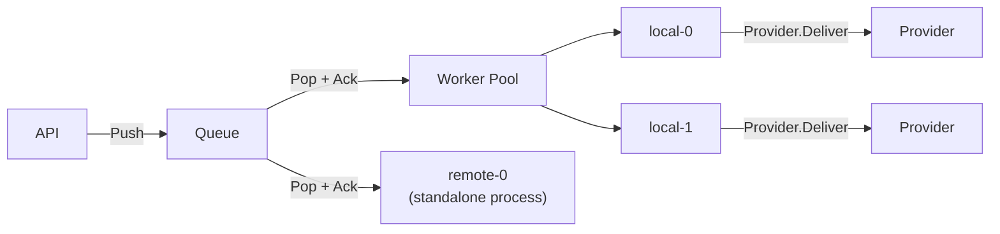
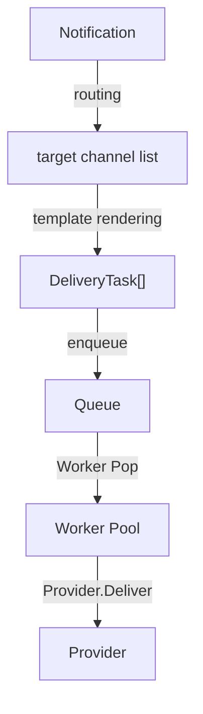

# Core Design

## System Positioning

Herald is event-driven delivery infrastructure: a unified Worker model, with task distribution taking the Queue as its backbone. It is not a Plugin system, not a Webhook aggregation tool, and not a push SDK for business code.

## Core Concepts

### Unified Worker Model

All Workers are the same kind of thing; only `mode` distinguishes the deployment method:

A local worker is an in-process goroutine that calls built-in Providers directly; a remote worker is a standalone process (`heraldd worker`) that consumes tasks from a shared Queue.

**"Who does it" is a deployment question; "how it is done" is a Provider question.** The Queue is the only task distribution channel.

### Queue as Backbone

The Queue provides reliable consumption semantics (Ack/Nack) and supports backpressure and persistence (Redis mode).

### Provider vs Worker

| Concept | Responsibility | Concern |
|------|------|--------|
| Provider | Implements the Deliver logic | How to send |
| Worker | Consumes tasks from the Queue | Who does it |

### Queue Implementations

| Implementation | Use case | Remote Worker |
|------|---------|---------------|
| `memory` | Single machine, development | Not supported |
| `redis` | Distributed, production | Supported |

Switching implementations only requires a config change, with zero code changes.

### WebSocket Management Channel

WebSocket is not used for task distribution; it serves only as the management channel for remote Workers:

- Registration (report ID and capabilities)
- Heartbeat (keep-alive, automatic deregistration on timeout)
- Status reporting (session expired, QR code scan needed, etc.)

## Delivery Abstraction

### Notification → DeliveryTask

### Payload Kinds

| PayloadKind | Description | Applicable Providers |
|-------------|------|--------------|
| `content` | Rendered content | Telegram, Email, Feishu, etc. (the default when no Capability is declared) |
| `provider_template` | Vendor template | Alibaba Cloud SMS, Tencent Cloud SMS |
| `raw` | Raw pass-through | Channels declaring the raw capability: FCM / APNs / JPush / Getui / Webhook (Worker Providers declare no Capability and go through the content default) |

## Design Principles

### 1. HTTP First

The primary interface is the HTTP REST API.

### 2. Queue First

The Queue is the only task distribution channel; there is no second path.

### 3. Template First

Template definitions are channel-independent: define once, reuse across multiple channels.

### 4. Deploy Flexible

- Single machine: `memory` queue + local workers
- Distributed: `redis` queue + local workers + remote workers
- Config switch, code unchanged
