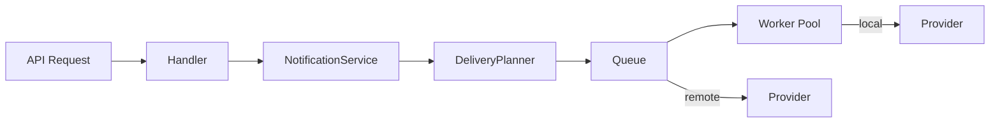

# Directory Structure

## Project Structure

```
herald/
├── herald.go                 # library-form entry (herald.New Facade)
├── cmd/
│   └── heraldd/              # unified entry (serve / worker subcommands)
│
├── config/                   # configuration management (Load/Default)
│   └── config.go
│
├── core/                     # core modules
│   ├── types.go              # core types (Notification, DeliveryTask, Queue)
│   ├── provider.go           # Provider/CapableProvider interfaces + Capability
│   ├── worker/               # unified Worker architecture
│   │   ├── pool.go           # Worker Pool (manages local worker goroutines)
│   │   └── registry.go       # Worker registry (local + remote)
│   ├── dispatch/             # dispatcher (a thin wrapper over the Worker Pool)
│   │   └── dispatcher.go
│   ├── queue/                # task queue
│   │   ├── queue.go          # Queue interface
│   │   ├── memory.go         # in-memory queue implementation
│   │   ├── redis.go          # Redis Stream implementation
│   │   └── factory.go        # queue factory
│   ├── route/                # route engine (routes + level_routes)
│   ├── retry/                # retry mechanism
│   ├── errclass/             # six-class Provider error classification
│   ├── dedup/                # dedup mechanism
│   ├── limiter/              # rate limiting mechanism
│   ├── runtime/              # Runtime management (Provider registration + delivery + retry)
│   │   └── manager.go
│   ├── service/              # service layer
│   │   ├── notification.go   # NotificationService orchestration layer
│   │   └── planner.go        # DeliveryPlanner (payload/format selection)
│   ├── template/             # template system
│   ├── audience/             # audiences and recipients (audiences/recipients tables)
│   ├── groups/               # notification groups (group: expansion)
│   ├── roster/               # on-call roster
│   ├── rules/                # rule engine (silence/inhibit/for/rerouting)
│   ├── ack/                  # alert acknowledgement
│   ├── escalation/           # escalation policies
│   ├── incident/             # incidents (ack aggregation, state derivation)
│   ├── auth/                 # authentication (login/refresh/me)
│   ├── jwt/                  # JWT issuing and verification
│   ├── user/                 # user model
│   ├── logstore/             # delivery log storage
│   ├── httpclient/           # unified HTTP client
│   ├── websocket/            # WebSocket (remote Worker management channel)
│   │   ├── server.go         # WebSocket server
│   │   └── hub.go            # Worker registration/heartbeat management
│   └── ...
│
├── api/                      # HTTP API
│   ├── handler.go            # request handlers + common responses
│   ├── handler_*.go          # per-resource handlers (notify/alerts/incidents/... 15 in total)
│   ├── idempotency.go        # idempotency key storage
│   └── server.go             # HTTP server + route registration
│
├── protocol/                 # internal protocol definitions
│   └── message.go            # WebSocket message types
│
├── providers/                # Provider implementations
│   └── builtin/              # built-in Providers (19 Factories)
│       ├── registry/         # Provider registration
│       ├── log/              # log
│       ├── telegram/         # Telegram
│       ├── feishu/           # Feishu
│       ├── wecom/            # WeCom
│       ├── dingtalk/         # DingTalk
│       ├── slack/            # Slack
│       ├── discord/          # Discord
│       ├── email/            # email
│       ├── webhook/          # Webhook
│       ├── aliyunsms/        # Alibaba Cloud SMS
│       ├── tencentsms/       # Tencent Cloud SMS
│       ├── neteasesms/       # NetEase Yunxin SMS
│       ├── wechat/           # WeChat (ServerChan/PushPlus/WxPusher)
│       ├── wechatmp/         # WeChat Official Account
│       ├── fcm/              # FCM push
│       ├── apns/             # APNs push
│       ├── jpush/            # JPush
│       ├── getui/            # Getui
│       └── worker/           # Worker Provider (proxies remote Workers)
│
├── apps-sdk/                 # integrator SDK (app namespace onboarding)
│   └── go/                   # Go SDK
├── worker-sdk/               # Worker SDK
│   └── go/                   # Go SDK + example
│
├── internal/                 # internal packages
│   └── logger/               # log management
│
├── examples/                 # examples
│   └── quickstart/           # quickstart example (counted in the coverage gate)
├── dashboard/                # frontend console (Vite + Vitest)
├── tools/                    # coverage gate scripts (covermerge/zero_check)
├── docs/                     # documentation
├── config.yaml               # configuration file
├── Makefile                  # build script
└── README.md
```

## Data Flow



## Configuration Example

```yaml
# scheduler mode
queue:
  type: memory          # memory | redis
  workers: 0            # 0 = CPU*2+1

# distributed mode
queue:
  type: redis
  workers: 4
  redis:
    addr: "localhost:6379"
    stream: "herald:tasks"
    group: "herald-workers"
```
