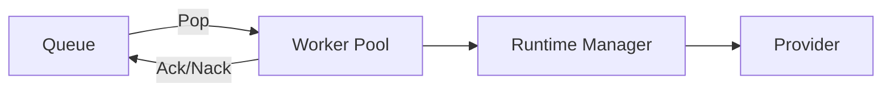
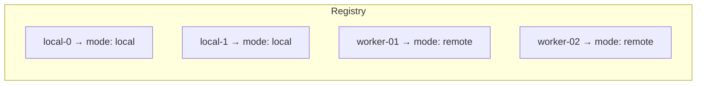
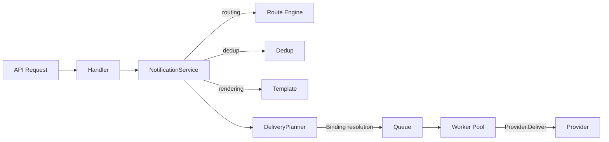

> English · [中文](./modules.md)

# Module Design

## Core Modules

### Worker Pool (unified Worker pool)

The Worker Pool manages a set of Workers that uniformly consume tasks from the Queue and deliver them:



**Core responsibilities:**

1. Start N local worker goroutines
2. Each worker loops: Pop → Deliver → Ack/Nack
3. Manage remote Worker registration information

**Source location:** `core/worker/pool.go`

### Registry (Worker registry)

Uniformly manages the metadata of all Workers:



**Source location:** `core/worker/registry.go`

## Data Flow



## Core Types

### Notification (notification intent)

The API-layer input, describing "what the user wants to send".

```go
type Notification struct {
    ID           string
    Type         string
    Level        string
    AudienceID   string   // audience dimension (empty means broadcast)
    Channels     []string
    Recipients   map[string][]string
    TemplateRef  string
    Params       map[string]any
    Content      *DirectContent
    CreatedAt    time.Time
    RelationType string   // subscription / enrollment (audience relation context)
    Source       string   // entry source (bot / preference_center / admin / app:<ns>)
}
```

### DeliveryTask (delivery task)

The Provider-layer input, describing "how to send to a specific channel".

```go
type DeliveryTask struct {
    ID          string
    Provider    string
    Targets     []string
    Payload     DeliveryPayload
    Level       string
    AlertID     string         // acknowledgement identity passed through to the interactive card buttons
    Status      DeliveryStatus // delivery state machine (queued/delivering/retrying/delivered/failed/dead)
    RetryCount  int            // retries already performed (attempts = RetryCount + 1)
    MaxAttempts int            // total attempt budget recorded at the first delivery
    LastError   string         // the last error when the terminal state is failed/dead
    CreatedAt   time.Time
    NextRetryAt *time.Time     // held by the queue while waiting for a backoff redelivery
    RelationType string        // subscription / enrollment (audience relation context)
    Source       string        // entry source (bot / preference_center / admin / app:<ns>)
    AudienceID   string        // §13.4 query dimension: whom it is delivered to (empty for anonymous notify)
    Category     string        // §13.4 query dimension: which category triggered it
    EventID      string        // integrator event identity, echoed back with the §13.5 callback
}

type DeliveryPayload struct {
    Kind             PayloadKind
    Content          *RenderedContent
    ProviderTemplate *ProviderTemplatePayload
    Raw              map[string]any
}
```

### Queue (task queue)

```go
type Queue interface {
    Push(ctx context.Context, task *DeliveryTask) error
    Pop(ctx context.Context) (*DeliveryTask, error)
    Ack(ctx context.Context, taskID string) error
    Nack(ctx context.Context, taskID string, reason error) error
    Size() int
    Close() error
}
```

## Module List

### 1. NotificationService

The core orchestration layer, whose flow is:

1. **Dedup** — a stable content-based SHA256 key
2. **Routing** — resolve the target channels from type/level
3. **Template rendering** — substitute template variables
4. **Delivery planning** — generate a DeliveryTask for each channel
5. **Enqueue** — push to the Queue

### 2. DeliveryPlanner

Generates a `DeliveryTask` from the Provider's capabilities and the template Binding:

- **SMS Provider** → `ProviderTemplatePayload`
- **Content Provider** → `RenderedContent`

### 3. Template + Binding

One business template can map to multiple channel configurations:

```yaml
templates:
  server_alert:
    bindings:
      email:        { format: html }
      telegram:     { format: markdown }
      aliyunsms:
        template_code: "SMS_123456"
        params: { "主机": "host", "状态": "status" }
```

### 4. Route Engine

Responsible for: `Notification Type/Level → Provider`

### 5. Retry

Hooked into `runtime.Manager.Deliver()`, supporting exponential-backoff retry.

### 6. Dedup

A stable content-based key (SHA256), with a 5-minute window.

### 7. Queue

The queue abstraction; current implementations:

| Implementation | Use case | Remote Worker |
|------|---------|---------------|
| `memory` | single-machine deployment | Not supported |
| `redis` | distributed deployment | Supported |

### 8. WebSocket Hub

The management channel for remote Workers (not a task distribution channel):

- Worker registration and capability recording
- Heartbeat keep-alive and deregistration on timeout
- Status event reporting

### 9. Provider Capability

Every Provider declares its own capabilities:

```go
type ProviderCapability struct {
    PayloadKinds     []PayloadKind
    ContentFormats   []string
    SupportsBatch    bool
    SupportsTemplate bool
}
```
