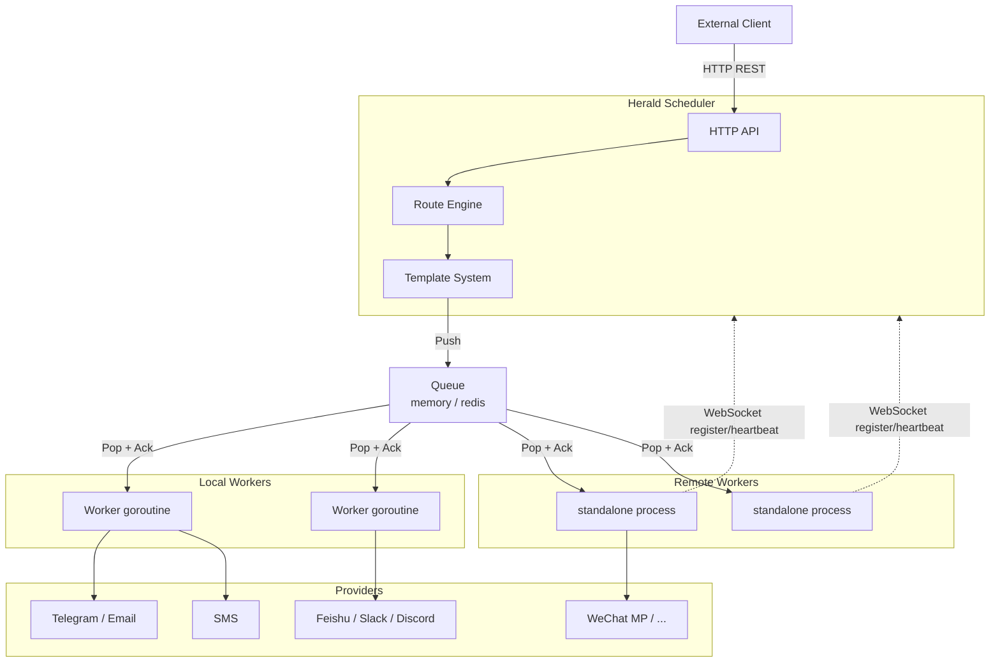

> English · [中文](./overview.md)

# Architecture Overview

## Project Positioning

Herald is a:

> **Lightweight, Provider-agnostic Subscription & Delivery Hub**

It provides business systems, operations, CI/CD, Agents, and automation tasks with unified notification orchestration, audience management, and reliable multi-channel delivery; the notified party decides — who receives what category, on which channel, and at what frequency is determined by the audience's own relations. Lightweight Notification Orchestration & Delivery is how it works; Provider-agnostic is its boundary promise. For the conceptual layering and terminology boundaries, see the [Conceptual Boundaries and Layering Audit](../design-audience-boundaries.en.md).

**Core flow:**

```
Event → Notification → Routing → Delivery Task → Queue → Worker → Provider
```

- **Notification** describes "what to notify about, whom it targets, and which template to use", and knows nothing about Provider details;
- **Routing** expands a Notification into a number of **Delivery Tasks** (audience resolution + channel routing);
- each Delivery has its own state and its own retry, separate from the Notification's acceptance state;
- for the complete domain model (terminology contract, audience-layer extensions, landing status) see the [Audience Domain Model Overview](/design-audience-model.en).

## Domain Model and Boundaries

Herald's domain model unfolds around the complete journey of a single notification through the system:

```text
Audience (whom to notify) ── group:ops / user:alice
    ↓
Recipient (who exactly)       Channel (which kind of notification: ci / ops / security)
    ↓
Endpoint (which address)      Template (how the content is generated)
    ↓
Routing (which deliveries it expands into)
    ↓
Delivery Task (one concrete channel delivery) → Queue → Worker → Provider
```

The model must hold the following boundaries; they are the core of this architecture:

```text
Notification ≠ Delivery Task      —— one notification can expand into several deliveries, and the states are never conflated
Audience     ≠ Channel            —— "whom to notify" and "which kind of notification" are two separate dimensions
Channel      ≠ Provider           —— the logical channel is decoupled from the delivery implementation; a channel can swap providers
Recipient    ≠ Endpoint           —— one person can own several addresses, and an address can switch channels
Routing      ≠ Delivery           —— expansion decisions and execution tasks are separate
Provider     ≠ Business Logic     —— a Provider only builds requests / calls / translates errors
```

The landing status of each boundary is in the [Audience Domain Model Overview](/design-audience-model.en) §13; the batch-by-batch execution record and the deferred-item rulings are in the [Status Audit](/design-audience-audit.en) (Phase 0-9 has fully landed): Notification / Channel (routes routing + an independent `channels` config block, with explicit provider > channels block > routes table) / Delivery Task (an explicit state machine queued/delivering/retrying/delivered/failed/dead + MaxAttempts/LastError + NextRetryAt) / Queue / Worker / Provider, notification groups (`group:`-form audiences), `user:`-level Recipients with multiple Endpoints (config-driven: `audiences` / `recipients` config blocks + `user:` reference expansion), the six-class Provider error classification (Temporary/Permanent/RateLimited/Authentication/InvalidRequest/Timeout, with the classification riding the error chain and the wire text unchanged), and the notify API's domain fields (`channel` / `audience` / `data` / `idempotency_key`, see [REST API](/api/rest.en#notify-receivers)). The wait for retryable failures lives on the queue side: the task is re-enqueued carrying `next_retry_at` (when the queue implementation provides the `Scheduler` capability), and the worker does not sleep the backoff. Logs and Delivery state have landed as separate things: logs narrow to a stream of fact events (`/api/v1/logs`, with event-outcome vocabulary), while the delivery state machine and retry evolution live independently at `/api/v1/deliveries` (see [REST API](/api/rest.en#deliveries-list)). The audience layer's subscription-side extensions (relations / ContactSurface / Preference / Digest / RSS / integration API) are advanced batch by batch per the [relation detail design](/design-audience-relations.en).

## Core Design Ideas

### 1. HTTP First

Herald's primary user interface is the **HTTP REST API**, not an SDK. It can be called with plain curl; scripts, CI/CD, and any language need to install nothing, pressing the onboarding cost down to a single HTTP request.

### 2. Queue as Backbone

The Queue is the only task distribution channel. All Workers (local or remote) consume tasks from the Queue.

```
API → Queue → Worker Pool
                  ├── local worker (goroutine) → builtin provider
                  └── remote worker (standalone process) → custom provider
```

### 3. Unified Worker Model

All Workers are the same concept; only `mode` distinguishes the deployment method:

| Worker type | Deployment | Task source |
|------------|------|---------|
| Local | in-process goroutine | Queue (memory/redis) |
| Remote | standalone process | Queue (redis) |

### 4. Event First

Herald's core responsibility is handling events; sending a message is only the last link in the event-handling chain.

**Example event:**

```json
{
  "type": "node.offline",
  "labels": {
    "region": "shanghai"
  }
}
```

## Overall Architecture



## Run Modes

```bash
# single-machine mode (memory queue + local workers)
heraldd serve --config config.yaml

# distributed: the scheduler
heraldd serve --config scheduler.yaml

# distributed: a remote worker
heraldd worker --config worker.yaml
```

## Final Positioning

**Lightweight, Provider-agnostic Subscription & Delivery Hub**. In practice: the business side describes only "what happened, what to notify about, and whom to notify"; the routing of audiences/channels/rules, the queue and the Workers, and the independent state and independent retry of deliveries are all consolidated inside Herald; who it is delivered to, on which channel, and at what frequency is decided by the audience's relations and Preferences.
