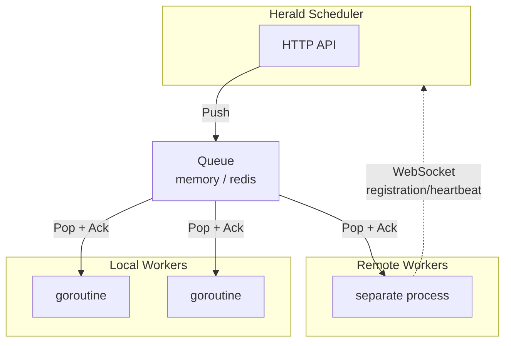

# Worker Architecture

## Unified Worker Model

In Herald, all Workers are the same concept, distinguished by `local`/`remote` deployment:



| Attribute | Local Worker | Remote Worker |
|------|-------------|---------------|
| Deployment | In-process goroutine | Separate process (`heraldd worker`) |
| Task source | Popped from the Queue | Popped from the shared Queue (Redis) |
| Communication | Direct Provider calls | WebSocket registration + Queue consumption |
| Best for | Builtin Providers (Telegram, Email, etc.) | Providers that need a special environment |

## Launch Modes

```bash
# Scheduler mode (starts local workers automatically)
heraldd serve --config config.yaml

# Remote Worker mode
heraldd worker --config worker.yaml
```

## Worker Registry

All Workers (local and remote) are registered in a unified Registry:

```go
type Info struct {
    ID            string    // worker ID
    Mode          Mode      // "local" or "remote"
    Capabilities  []string  // Supported Provider types
    Status        string    // online / offline
    ConnectedAt   time.Time
    LastHeartbeat time.Time
}
```

- **Local Worker**: registered automatically at startup, unregistered automatically when the process exits
- **Remote Worker**: registers over WebSocket at startup, keeps alive with periodic heartbeats, and is unregistered automatically on timeout

## Queue Interface

The Queue is the only task dispatch channel and supports reliable consumption semantics:

```go
type Queue interface {
    Push(ctx context.Context, task *DeliveryTask) error
    Pop(ctx context.Context) (*DeliveryTask, error)
    Ack(ctx context.Context, taskID string) error
    Nack(ctx context.Context, taskID string, reason error) error
    Size() int
    Close() error
}
```

| Implementation | Use Case | Remote Worker Support |
|------|---------|-------------------|
| `memory` | Single-machine deployment | Not supported |
| `redis` | Distributed deployment | Supported |

## WebSocket Management Channel

WebSocket is not used for task dispatch; it serves only as the management channel for remote Workers: at startup the Worker reports its ID and capabilities to complete registration, then keeps alive with heartbeats at a fixed interval and is unregistered automatically on timeout; Worker state changes (session expired, QR scan required, etc.) are also reported over this channel.

### Registration Message (Worker → Core)

```json
{
  "type": "register",
  "worker_id": "wechat-worker-01",
  "mode": "remote",
  "platform": "linux",
  "version": "1.0.0",
  "capabilities": ["wechatmp", "wechat"]
}
```

### Heartbeat Message (Worker → Core)

```json
{
  "type": "heartbeat",
  "worker_id": "wechat-worker-01",
  "timestamp": 1716780000
}
```

`status` is an optional free-form map in the protocol (`map[string]interface{}`, `protocol/message.go`); neither the current SDK nor the builtin worker populates it, so the examples send only `worker_id` + `timestamp`.

## Protocol Messages

### Registration Acknowledgment (Core → Worker)

```json
{
  "type": "register_ack",
  "worker_id": "wechat-worker-01",
  "success": true,
  "server_id": "herald-core-01",
  "timestamp": 1716780000
}
```

### Event Message (Worker → Core)

```json
{
  "type": "event",
  "worker_id": "wechat-worker-01",
  "event_type": "offline",
  "timestamp": 1716780000,
  "data": {
    "reason": "session_expired"
  }
}
```

The protocol defines seven message types in total (`protocol/message.go`): the four above are in use, while `dispatch`/`ack`/`error` are defined but have no production call sites in the repo — task results go through queue Ack/Nack, not WebSocket.

## Applicable Scenarios

Remote Workers fit: browser automation (WeChat Official Account, web-based tools), mobile bridging (Android notification bridge), scenarios that need a GUI session or special system permissions, and deployments that want to isolate channel crashes from the scheduler process.

## Best Practices

For development and small-scale deployments, the `memory` queue is enough; switch to `redis` when going distributed, with zero code changes. A Remote Worker runs as a separate process, so a crash does not take down the scheduler; the builtin binary `heraldd worker` reconnects and re-registers automatically after a disconnect, and a dropped heartbeat surfaces connection problems promptly (`worker-sdk` does not reconnect automatically — recovery means restarting the process).
